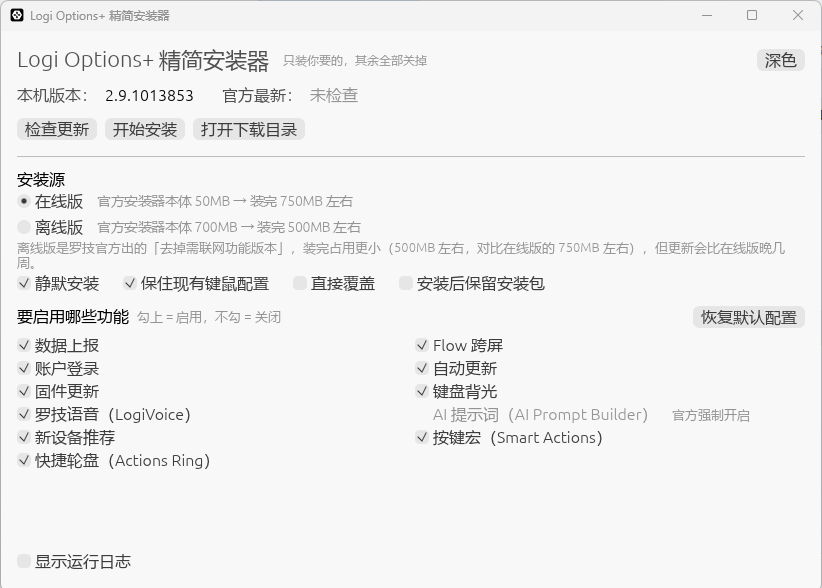

# Logi Options Plus Mini

[中文](README.md) | [English](README_EN.md)

**Logi Options+ mini** 提供了一种选择来自定义 Logi Options+，方便用户能够更好地控制其功能。

🎉 本仓库的 Windows 图形界面工具发布！Windows 用户欢迎[下载](https://github.com/tjsky/logi-options-plus-mini/releases)体验，并反馈使用过程中遇到的问题或建议 ❤️



<picture>
  <source media="(prefers-color-scheme: dark)" srcset="https://github.com/user-attachments/assets/11adddd4-bf0e-4e6d-b164-483b2521e228">
  <source media="(prefers-color-scheme: light)" srcset="https://github.com/user-attachments/assets/86024914-4650-4966-ba81-77d59fee5696">
   
</picture>


## 项目简介

参考官方[Logitech Options 软件的批量安装和配置](https://prosupport.logi.com/hc/zh-cn/articles/6046882446359-Logitech-Options-软件的批量安装和配置)

项目通过官方安装包命令行选项定制化Logi Options+功能。
支持macOS原生应用、macOS Shell、Windows PowerShell，以及 Windows 图形界面工具。

上游项目为 macOS 提供了图形界面应用；本仓库的 **Windows 图形界面工具**则是面向 Windows 独立重写的实现（Rust，基于同一套官方安装器参数逻辑），并增加了一些便利功能——例如适配安装体积更小的官方**离线版**、安装前自动备份/还原键鼠配置等。Windows 用户优先推荐使用它；macOS 用户请使用上游的原生应用。

## Windows 图形界面工具

一个 **6 MB** 的单文件小工具，免安装、无需任何运行时，在**安装阶段**就把不想要的功能关掉，而不是装完一个 750 MB 的全家桶再逐项去设置里翻。

> 本工具仍然使用罗技官方安装器本体，只负责按你的勾选拼装安装参数，并校验安装包的官方数字签名——不修改、不替换任何官方程序。

### 功能

- **逐项功能开关**：数据上报、Flow 跨屏、账户登录、自动更新、固件更新、键盘背光、罗技语音、新设备推荐、按键宏、快捷轮盘——想开的开，不想开的关
- **两种官方安装源**
  - **在线版**：官方安装器本体 50 MB，装完占用 750 MB 左右
  - **离线版**：罗技官方出的「去掉需联网功能版本」，安装器本体 700 MB，装完占用 500 MB 左右，更新会比在线版晚几周
- **保住现有键鼠配置**：安装前自动备份按键与鼠标自定义，装完自动还原
- **安装后保留安装包**：不删除已下载的安装包，方便重复安装
- **数字签名校验**：下载的安装包必须通过 Authenticode 校验（签发者 Logitech Inc）才会安装
- **推荐离线版**：勾选组合接近离线版形态时，提示一键切换
- 深浅色主题跟随系统；全程操作日志可随时查看

### 下载

前往 [Releases](https://github.com/tjsky/logi-options-plus-mini/releases) 下载 `logi-options-plus-mini.exe`。

- 支持 Windows 10 / 11（x64）
- 单文件，免安装，不依赖 .NET 或 WebView

### 使用

1. 双击运行，选择安装源（默认在线版）
2. 在「要启用哪些功能」里勾上想启用的，不勾的会被关闭
3. 点「开始安装」，在 UAC 弹窗点「是」，剩下的交给它

安装过程会临时结束 Logi Options+ 相关进程，装完即恢复正常。

### 命令行

| 命令 | 作用 |
| --- | --- |
| `logi-options-plus-mini.exe --check` | 检查本机版本与官方最新版本 |
| `--plan` | 只列出将要执行的操作，不动系统 |
| `--install` | 直接安装，可配合 `--offline`、`--features dfu,backlight` 使用 |

### 图形界面工具常见问题

**为什么 AI 提示词（AI Prompt Builder）勾不了？**
官方安装器已经不接受这个开关，装完就是开着的，关不掉。

**换了勾选重新安装，为什么没生效？**
官方安装器遇到相同版本会直接跳过安装，功能开关不会被重新写入。想让新勾选生效，可以：先卸载再装；换一个不同版本；或改用离线版覆盖安装——离线包会直接重装并重写开关，代价是包内版本通常旧几周。

**在线版和离线版怎么选？**
不确定就选在线版（版本最新，可配置功能最全）。希望有更小的硬盘占用且不需要那些联网的功能、或想在不卸载的情况下改功能开关，不需要追最新版本，选离线版。

**会不会弄丢我的按键设置？**
勾上「保住现有键鼠配置」就不会：设置会先备份，装完自动还原。个别文件被占用还原不了时，备份会保留并提示。

## 特性

- 定制化Logi Options+功能
- 易于使用的交互设计
- 卸载升级时自动保留配置
- 可定制功能
  - analytics 用户分享应用程序使用情况和诊断数据
  - flow
  - sso 用户登录应用程序的功能
  - update 应用程序更新
  - dfu 设备固件更新
  - logivoice 罗技语音功能
  - backlight 键盘背光
  - smartactions 按键宏
  - actions-ring 快捷轮盘
  - device-recommendation 设备推荐功能
  - ~~aipromptbuilder~~ 官方安装器已移除该参数，无法再通过命令行控制

## 使用方法

### 使用 macOS 原生应用

下载最新版本 [here](https://v.qetesh.cc/d/Public/Logi%20Options%2B%20mini.dmg)

[](https://v.qetesh.cc/d/Public/Logi%20Options%2B%20mini.dmg)

🔔 由于没有使用开发者证书签署应用，macOS可能会显示安全警告，需前往系统设置 → 隐私与安全 → 已阻止“Logi Options+mini”以保护Mac。然后点击“仍要打开”以运行该应用程序。


### 使用 macOS Shell

1. 克隆此项目到本地

   ```bash
   git clone https://github.com/tjsky/logi-options-plus-mini.git
   cd logi-options-plus-mini
   ```
2. 运行Shell脚本（需要 `sudo`权限卸载旧版本）

  ```bash
  chmod u+x logi-options-plus-mini.command
  ./logi-options-plus-mini.command

  ##############################################################
  2024年12月15日 星期日 23时32分33秒 +08 | 开始安装 Logi Options+
  ##############################################################

1.  analytics:           允许收集个人使用数据和诊断信息
2.  flow:                Flow 跨屏功能 (默认为 Yes)
3.  sso:                 启用 罗技账户 登录模块
4.  update:              启用 Logi Options+ 自动更新
5.  dfu:                 启用 设备固件 自动更新
6.  backlight:           启用 键盘背光 支持
7.  logivoice:           启用 罗技语音功能（LogiVoice）
8.  device-recommendation: 启用 新产品推荐（新产品广告）
9.  smartactions:        启用 Smart Actions (按键宏)
10. actions-ring:        启用 Actions Ring（快捷启动）
11. all (全部开启)
直接按回车键，则执行最小化精简安装，不开启任何额外功能

如需自定义请输入选项 (例如 '0 2 6 10', 默认为 最小化精简安装): 
  ```

### 使用 Windows Shell

1. 克隆此项目到本地

   ```bash
   git clone https://github.com/tjsky/logi-options-plus-mini.git
   cd logi-options-plus-mini
   ```

   如果你不会git或者你不知道怎么给git设置代理（虽然我感觉不至于，你都来github了……）你可以在网页里下ZIP包，解压后使用
   如果还嫌麻烦可以从这里下只有脚本的：[蓝奏云](https://tjsky.lanzouq.com/i5Vrp3fzq9dc)
   
   
3. 双击bat脚本 `Run_Install.bat`即可，(脚本会赋予临时的 ExecutionPolicy 权限)

  ```powershell
##############################################################
01/09/2026 10:48:24 | 开始安装 Logi Options+
##############################################################

01/09/2026 10:48:24 | 检测到您位于中国地区，使用 CN 下载源
01/09/2026 10:48:24 | 正在下载安装包: https://download.logitech.com.cn/web/ftp/pub/techsupport/optionsplus/logioptionsplus_installer.exe
01/09/2026 10:49:05 | 下载成功。

请选择你想保留/开启的功能：
0.  quiet:               静默安装（无人值守安装）
1.  analytics:           允许收集个人使用数据和诊断信息
2.  flow:                Flow 跨屏功能 (默认为 Yes)
3.  sso:                 启用 罗技账户 登录模块
4.  update:              启用 Logi Options+ 自动更新
5.  dfu:                 启用 设备固件 自动更新
6.  backlight:           启用 键盘背光 支持
7.  logivoice:           启用 罗技语音功能（LogiVoice）
8.  device-recommendation: 启用 新产品推荐（新产品广告）
9.  smartactions:        启用 Smart Actions (按键宏)
10. actions-ring:        启用 Actions Ring（快捷启动）
11. all (全部开启)
直接按回车键，则执行最小化精简安装，不开启任何额外功能

如需自定义请输入选项 (例如 '0 2 6 10', 默认为 最小化精简安装): 

  ```

脚本将会自动下载官方安装包，并进行精简安装。

## 系统要求

- macOS
- Windows
- 网络连接以下载官方安装包

## FAQ

- 部分Mac无法使用官方方式卸载，需使用第三方工具卸载后重新运行。已测试使用 `Pearcleaner`卸载后可正常运行安装
- Windows系统下安装时报错`安装失败.退出提示:1287` ：你的系统安全配置阻止了安装，尝试右键bat脚本文件，选择“以管理员权限运行”
- Windows系统下安装时报错`安装失败.退出提示:1008` ：你的系统安全配置阻止了安装，尝试右键bat脚本文件，选择“以管理员权限运行”
- 启用了SSO（罗技账户登录模块）后无法上传配置信息到云端：表现为可登录，可下载云端配置，但无法上传配置到云端，这貌似是罗技自己安装程序中的bug 。
- 
## 致谢 / 说明
- 本项目基于 [Qetesh](https://github.com/Qetesh) 的 [logi-options-plus-mini](https://github.com/Qetesh/logi-options-plus-mini) 修改开发。 感谢原作者的开源贡献。
- 分叉信息：由 [tjsky](https://github.com/tjsky) 分叉并修改：
 1. 添加windows系统下bat一键运行。
 2. 自动判断用户区域切换语言。
 3. 我没有mac打包环境，所以提供 macOS 原生应用为原作者的版本。
 4. 新增 Windows 图形界面工具（Rust，独立重写实现，遵循上游 Apache 2.0 许可证开源）。

### 贡献者
<a href="https://github.com/tjsky/logi-options-plus-mini/graphs/contributors">
  
</a>


### Stars历史
<a href="https://www.star-history.com/?repos=tjsky%2Flogi-options-plus-mini&type=date&legend=top-left">
 <picture>
   <source media="(prefers-color-scheme: dark)" srcset="https://api.star-history.com/chart?repos=tjsky/logi-options-plus-mini&type=date&theme=dark&legend=top-left" />
   <source media="(prefers-color-scheme: light)" srcset="https://api.star-history.com/chart?repos=tjsky/logi-options-plus-mini&type=date&legend=top-left" />
   
 </picture>
</a>


## 贡献

欢迎提交问题和请求。您可以通过以下方式贡献代码：

1. Fork 此仓库
2. 创建您的分支 (`git checkout -b feature/AmazingFeature`)
3. 提交您的更改 (`git commit -m 'Add some AmazingFeature'`)
4. 推送到分支 (`git push origin feature/AmazingFeature`)
5. 打开一个Pull Request


## 许可证

此项目使用 [Apache 许可证](LICENSE)。
