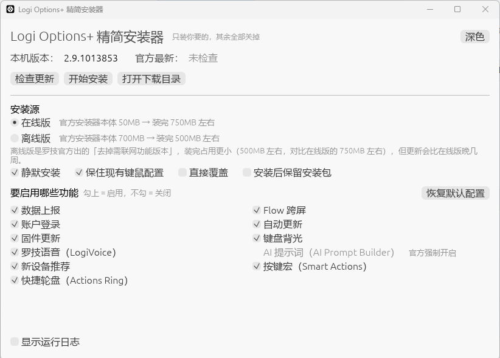

# Logi Options Plus Mini
[中文](README.md) | [English](README_EN.md)

**Logi Options+ mini** Provides an option to customize Logi Options+ so that the user can better control its functions.

🎉 The Windows GUI tool of this repository is now available! Windows users are welcome to [download](https://github.com/tjsky/logi-options-plus-mini/releases) it, try it out, and share any issues or suggestions ❤️


<picture>
  <source media="(prefers-color-scheme: dark)" srcset="https://github.com/user-attachments/assets/11adddd4-bf0e-4e6d-b164-483b2521e228">
  <source media="(prefers-color-scheme: light)" srcset="https://github.com/user-attachments/assets/86024914-4650-4966-ba81-77d59fee5696">
   
</picture>


## Project Overview
Refer to the official [Mass installation and configuration of Logitech Options+ software](https://prosupport.logi.com/hc/en-us/articles/6046882446359-Mass-installation-and-configuration-of-Logitech-Options-software)

This project customizes the Logi Options+ functionality through official installer command-line options. It supports macOS native applications, macOS Shell, and Windows PowerShell, plus a **Windows GUI tool**.

The upstream project provides a GUI application for macOS. The **Windows GUI tool** in this repository is an independent re-implementation for Windows (Rust, built on the same official installer argument logic) with additional conveniences — such as support for the smaller official **offline edition**, automatic backup/restore of your key and mouse settings before installing. Windows users are recommended to use it; macOS users should use the upstream native application.

## Windows GUI Tool

A **6 MB** single-file tool — no installer, no runtime required — that turns unwanted features **off at install time**, instead of installing a 750 MB full bundle and digging through settings afterwards.

> This tool still runs the official Logi Options+ installer. It only assembles installer arguments from your selections and verifies the digital signature of the downloaded package — it never modifies or replaces any official component.



### Features

- **Per-feature toggles**: analytics, Flow, account sign-in, auto-update, firmware update, keyboard backlight, LogiVoice, device recommendation, Smart Actions, Actions Ring — enable what you want, disable the rest
- **Two official installation sources**
  - **Online edition**: the official installer itself is 50 MB; installed size is around 750 MB
  - **Offline edition**: Logitech's official "version without online features". The installer itself is 700 MB; installed size is around 500 MB. It updates a few weeks behind the online edition.
- **Keep your existing settings**: your key and mouse customizations are backed up before installing and restored afterwards
- **Keep the installer after setup**: downloaded installers are not deleted, so you can reuse them
- **Signature verification**: downloaded packages must pass Authenticode verification (signed by Logitech Inc) before installation
- **Offline suggestion**: when your selection is close to the offline defaults, a one-click switch is offered
- Theme follows system dark/light mode; full logs are available at any time

### Download

Grab `logi-options-plus-mini.exe` from the [Releases](https://github.com/tjsky/logi-options-plus-mini/releases) page.

- Windows 10 / 11 (x64)
- Single file, portable, no .NET or WebView dependency

### Usage

1. Run the executable and pick an installation source (online by default)
2. Under "Features to enable", check what you want to keep enabled; unchecked items will be turned off
3. Click "Install", accept the UAC prompt, and let it finish

The installation temporarily closes Logi Options+ related processes and everything returns to normal once done.

### Command line

| Command | Purpose |
| --- | --- |
| `logi-options-plus-mini.exe --check` | Compare installed version with the latest official one |
| `--plan` | List the actions that would be performed, without touching the system |
| `--install` | Install directly; combine with `--offline` and `--features dfu,backlight` |

### GUI tool FAQ

**Why can't I uncheck AI Prompt Builder?**
The official installer no longer accepts that switch. It is always installed and enabled.

**Why didn't my new feature selection take effect?**
When the same version is already installed, the official installer skips installation entirely and feature switches are not rewritten. To apply a new selection: uninstall first, install a different version, or use the offline edition as a cover install — the offline package reinstalls directly and rewrites the switches, at the cost of being a few weeks older.

**Which edition should I choose?**
When in doubt, choose the online edition (the newest version, with the full set of configurable features). Choose the offline edition if you want a smaller disk footprint and don't need the online-dependent features, or want to change feature switches without uninstalling first — and don't need to chase the latest version.

**Will I lose my button configurations?**
Not if you check "Keep your existing settings": they are backed up first and restored after installation. If some files are locked during restore, the backup is kept and you will be told.

## Features

- customizes the Logi Options+ functionality
- Automatically retain configuration when uninstalling and upgrading
- Customizable features:
  - analytics: user sharing of application usage and diagnostic data
  - flow
  - sso: user login 
  - update: application updates
  - dfu: device firmware updates
  - logivoice: Logitech voice 
  - smartactions
  - actions-ring
  - device-recommendation: device recommendation (macOS only)
- Easy-to-use

## Usage

### Using macOS Native Application

Download the latest version [here](https://github.com/Qetesh/logi-options-plus-mini/releases/latest)

[](https://github.com/Qetesh/logi-options-plus-mini/releases/latest)

🔔 Due to the application not being signed with a developer certificate. macOS may show a security warning, simply go to System Settings → Privacy & Security → "Logi Options+mini"was blocked to protect your Mac. and click “Open Anyway” to run the app.


### Using macOS Shell

1. Clone this project locally
    ```bash
    git clone https://github.com/Qetesh/logi-options-plus-mini.git
    cd logi-options-plus-mini
    ```

2. Run the shell script (requires `sudo` permission to uninstall the old version)
   - macOS
     ```bash
     chmod u+x logi-options-plus-mini.command
     ./logi-options-plus-mini.command

     ##############################################################
     2024年12月15日 星期日 23时32分33秒 +08 | Starting install of Logi Options+
     ##############################################################

     Please select the features you want to keep:
     1. analytics:             Shows or hides choice for users to opt in to share app usage and diagnostics data.
     2. flow:                  Shows or hides the Flow feature. Default value is Yes
     3. sso:                   Shows or hides ability for users to sign into the app.
     4. update:                Enables or disables app updates.
     5. dfu:                   Enables or disables device firmware updates.
     6. backlight:             Enables or disables keyboard backlight on the supported keyboards.
     7. logivoice:             Enables or disables LogiVoice feature.
     8. device-recommendation: Enables or disables device recommendation feature.
     9. smartactions:         Enables or disables Smart Actions feature.
     10. actions-ring:         Enables or disables Actions Ring feature.
     11. all
     Press enter for none

     Enter your choices(e.g. 2 6, default is none): 
     ```

   - Windows (Requires running the `Set-ExecutionPolicy -ExecutionPolicy RemoteSigned` command once in an administrator terminal)

     Right-click on the ps1 script and "Run with PowerShell"
     ```powershell
     ##############################################################
     12/17/2024 19:50:23 | Starting install of Logi Options+
     ##############################################################
     12/17/2024 19:50:24 | Downloading Logi Options+ Installer...
     12/17/2024 19:51:06 | Download completed successfully.
     12/17/2024 19:51:06 | Uninstalling existing version of Logi Options+...

     Please select the features you want to keep:
     1. analytics:             Shows or hides choice for users to opt in to share app usage and diagnostics data.
     2. flow:                  Shows or hides the Flow feature. Default value is Yes
     3. sso:                   Shows or hides ability for users to sign into the app.
     4. update:                Enables or disables app updates.
     5. dfu:                   Enables or disables device firmware updates.
     6. backlight:             Enables or disables keyboard backlight on the supported keyboards.
     7. logivoice:             Enables or disables LogiVoice feature.
     8. device-recommendation: Enables or disables device recommendation feature.
     9. smartactions:         Enables or disables Smart Actions feature.
     10. actions-ring:         Enables or disables Actions Ring feature.
     11. all
     Press enter for none

     Enter your choices (e.g. 2 6, default is none):
     ```

   The script will automatically download the official installer and perform a streamlined installation.

## System Requirements

- macOS
- Windows
- Internet connection to download the official installer

## FAQ

- Some Macs cannot be uninstalled using the official method, and a third-party tool is required for uninstallation and then re-running. It has been tested that after using `Pearcleaner` for uninstallation, it can run normally after installation.

## Contributors

<a href="https://github.com/Qetesh/logi-options-plus-mini/graphs/contributors">
  
</a>

## Contributing

Welcome to submit issues and requests. You can contribute code as follows:

1. Fork this repository
2. Create your branch (`git checkout -b feature/AmazingFeature`)
3. Commit your changes (`git commit -m 'Add some AmazingFeature'`)
4. Push to the branch (`git push origin feature/AmazingFeature`)
5. Open a Pull Request

## License

This project is licensed under the [Apache License](LICENSE).
